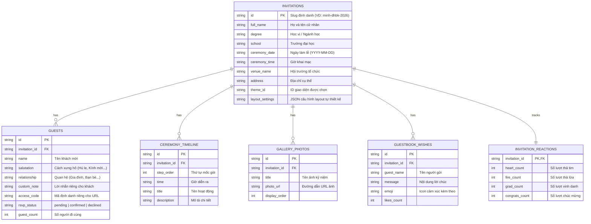

# Cấu Trúc Cơ Sở Dữ Liệu GradInvite (SQLite & Cloud DB Guide)

Tài liệu hướng dẫn quản lý, di chuyển (migration) và bàn giao cơ sở dữ liệu cho hệ thống Thiệp Mời Tốt Nghiệp Cá Nhân Hóa.

---

## 📁 Cấu Trúc Thư Mục Database

- **`db/schema.sql`**: File DDL định nghĩa toàn bộ 6 bảng dữ liệu, quan hệ khóa ngoại (`FOREIGN KEY ... ON DELETE CASCADE`) và các chỉ mục hiệu năng cao (`INDEXES`).
- **`db/seed.sql`**: Dữ liệu mẫu khởi tạo ban đầu (Tân cử nhân, Khách mời, Lịch trình, Ảnh kỷ yếu, Sổ lưu bút, Cảm xúc).
- **`db/init-db.js`**: Script khởi tạo hoặc reset database SQLite cục bộ.
- **`db/graduation.db`**: File cơ sở dữ liệu SQLite thực tế đang chạy trên máy.
- **`server/index.js`**: REST API Server (Node.js chuẩn không phụ thuộc thư viện ngoài) chạy tại cổng `http://localhost:3001`.

---

## 🗄️ Chi Tiết Các Bảng Dữ Liệu (Tables & Relations)

---

## 🚀 Hướng Dẫn Di Chuyển Lên Cloud (Supabase / PostgreSQL / Neon)

File `db/schema.sql` được viết hoàn toàn theo chuẩn ANSI SQL nên khi cần deploy lên các dịch vụ đám mây:
1. **Supabase / PostgreSQL**: Mở giao diện **SQL Editor** trong Supabase hoặc Neon, dán nội dung từ `db/schema.sql` rồi nhấn **Run**.
2. **Drizzle ORM / Prisma**: Subagent hoặc lập trình viên có thể ánh xạ trực tiếp 6 bảng này vào `schema.prisma` hoặc `schema.ts`.

---

## 📡 Các Điểm Cuối REST API Sẵn Sàng Sử Dụng (`http://localhost:3001`)

| Method | Endpoint | Mô Tả |
| :--- | :--- | :--- |
| `GET` | `/api/invitation?id=minh-dhbk-2026` | Lấy toàn bộ thông tin thiệp, khách mời, lịch trình, ảnh kỷ yếu, lời chúc |
| `POST` | `/api/rsvp` | Gửi xác nhận tham dự (`guestId`, `status`, `guestCount`, `note`) |
| `POST` | `/api/wishes` | Gửi lời chúc mừng mới lên Sổ lưu bút |
| `POST` | `/api/guests` | Thêm khách mời cá nhân mới |

